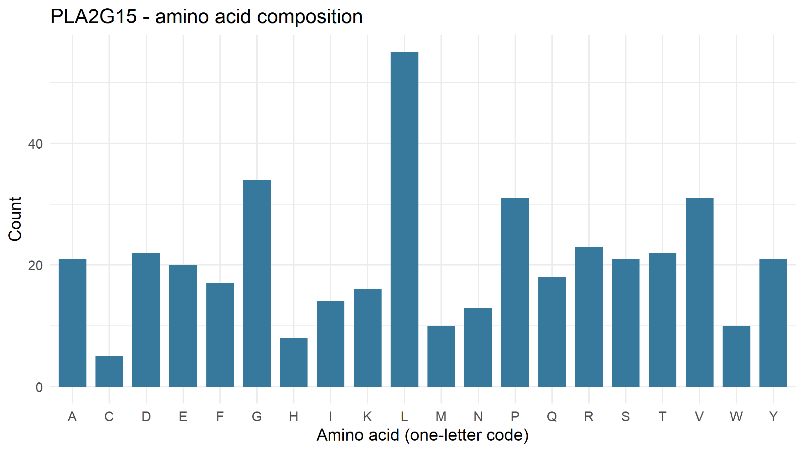
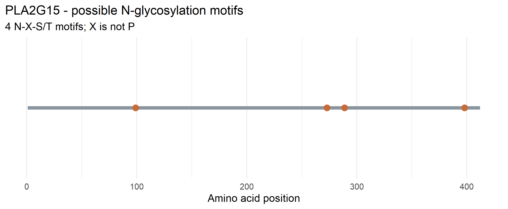

# PLA2G15 Lysosomal Enzyme Sequence Analysis

## Overview

This individual lab analyzes the human lysosomal enzyme encoded by **PLA2G15** using R and a protein sequence obtained from NCBI. The analysis calculates protein length and amino acid composition, identifies potential N-glycosylation motifs, and generates two figures.

- **Gene symbol:** PLA2G15
- **Protein:** Lysosomal phospholipase A and acyltransferase, isoform 1 precursor
- **Organism:** *Homo sapiens*
- **NCBI RefSeq protein accession:** [NP_036452.1](https://www.ncbi.nlm.nih.gov/protein/NP_036452.1)

## Enzyme Function

PLA2G15 encodes lysosomal phospholipase A and acyltransferase, also known as lysosomal phospholipase A2 (LPLA2). This enzyme helps break down certain phospholipids and related lipid molecules in lysosomes.

## Methods

The supplied R script (`lysosomal_enzyme_analysis.R`) downloaded the protein FASTA sequence from NCBI using the `rentrez` package. It calculated the protein length and amino acid composition, searched for potential N-glycosylation motifs, and generated figures using `ggplot2`.

A potential N-glycosylation motif follows the pattern **N-X-S/T**, where X is not proline. A detected motif is only a sequence-based prediction; it does not confirm glycosylation or the presence of a mannose-6-phosphate (M6P) tag.

## Results

- **Protein length:** 412 amino acids
- **Potential N-glycosylation motifs detected:** 4

The five most common amino acids reported by the script were:

| Amino acid | Count | Percentage |
|---|---:|---:|
| Leucine (L) | 55 | 13.35% |
| Glycine (G) | 34 | 8.25% |
| Proline (P) | 31 | 7.52% |
| Valine (V) | 31 | 7.52% |
| Arginine (R) | 23 | 5.58% |

## Figure 1. Amino Acid Composition

The figure shows the count of each standard amino acid in the PLA2G15 protein sequence. Leucine (L) was the most frequent amino acid in this analysis.

## Figure 2. Potential N-Glycosylation Motif Positions

The figure shows the positions of the four potential N-X-S/T motifs identified in the sequence. These are predicted sequence motifs, not experimental confirmation that the protein is glycosylated.

## Answers to the Five Lab Questions

### 1. What does your enzyme normally break down inside lysosomes?

PLA2G15 encodes an enzyme involved in breaking down certain phospholipids and related lipid molecules in lysosomes.

### 2. What is the total length of your protein, and which amino acids are most common?

The analyzed protein was **412 amino acids** long. The five most common amino acids were leucine (L, 55; 13.35%), glycine (G, 34; 8.25%), proline (P, 31; 7.52%), valine (V, 31; 7.52%), and arginine (R, 23; 5.58%).

### 3. How many potential N-glycosylation motifs did you find? Where are they located?

The script detected **4 potential N-glycosylation motifs** matching the N-X-S/T pattern, where X is not proline. Their exact positions and motif sequences are recorded in `results/PLA2G15_motif_positions.csv`.

### 4. Why can glycosylation matter for lysosomal proteins? Does finding a motif prove the protein is glycosylated?

Glycosylation can help proteins fold correctly, remain stable, and move through the cell's sorting and transport systems. For many lysosomal enzymes, carbohydrate modifications are also important for delivery to lysosomes. However, finding an N-X-S/T sequence motif does **not** prove that a sugar is attached. This sequence analysis also does not determine whether the protein has a mannose-6-phosphate (M6P) tag.

### 5. What could happen in the cell if your enzyme did not work properly?

If PLA2G15 does not function properly, certain lipid molecules may not be broken down normally and could accumulate or be processed abnormally in cells. The exact consequences depend on the nature and severity of the enzyme defect. This sequence analysis does not measure enzyme activity or establish that a functional defect is present.

## References and Resources

- NCBI Protein: [PLA2G15, NP_036452.1](https://www.ncbi.nlm.nih.gov/protein/NP_036452.1)
- NCBI: [National Center for Biotechnology Information](https://www.ncbi.nlm.nih.gov/)
